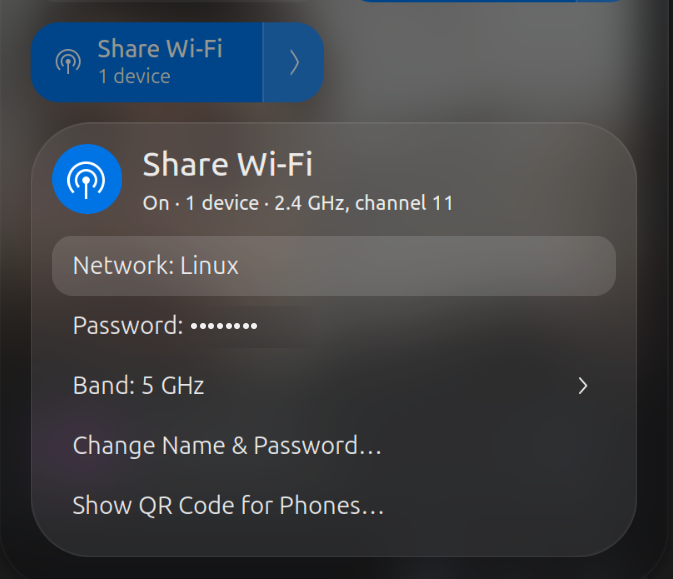
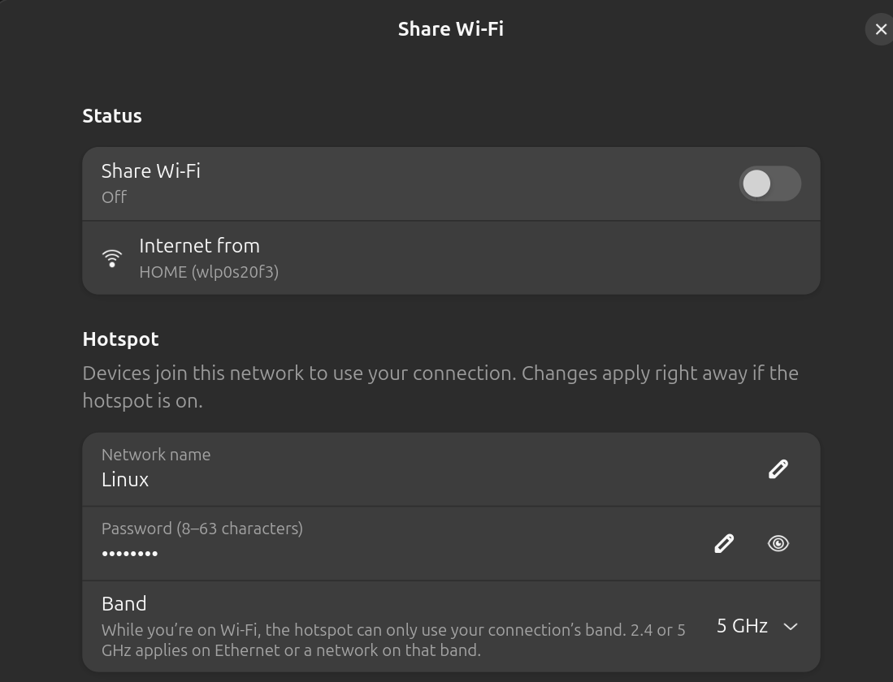

# Share Wi-Fi for GNOME

Share the Wi-Fi you're connected to with your phone, tablet or another
laptop, like **Mobile Hotspot** on Windows. One toggle in GNOME Quick
Settings, and you **stay connected to your Wi-Fi the whole time**.



[](https://github.com/Kumarsujay03/wifishare/actions/workflows/ci.yml)
[](https://github.com/Kumarsujay03/wifishare/releases/latest)
[](LICENSE)

## Features

- **Quick Settings toggle** with the device count, band and channel at a glance.
- **Stays on your Wi-Fi**: the hotspot runs on a second, virtual interface
  on the same card, so you're never disconnected (Ubuntu's built-in hotspot
  disconnects you).
- **Join by QR code**: phones scan it and connect, no typing.
- **Connected devices**: name, IP, MAC address, signal, time connected and
  data used for each device.
- **Band choice**: same as your Wi-Fi (default), 2.4 GHz or 5 GHz.
- **Settings window** with tabs for the hotspot, joining, devices and updates.
- **Command line** for everything: `wifishare on`, `status`, `clients`, …
- **Updates with one command**: `wifishare update`.
- **On only when you want it**: nothing runs until you turn it on, and
  turning it off removes everything.



## Requirements

- **GNOME Shell 45–50** (developed on Ubuntu with GNOME 50).
- **A Wi-Fi card that can be a client and a hotspot at the same time.** Most
  Intel cards can. Check with:

  ```bash
  iw list | grep -A4 'valid interface combinations'
  ```

  You need a line containing both `managed` and `AP`, for example
  `#{ managed } <= 1, #{ AP, P2P-client, P2P-GO } <= 1`.
- Your Wi-Fi on 2.4 GHz or a non-DFS 5 GHz channel (most home networks are).

## Install

```bash
git clone https://github.com/Kumarsujay03/wifishare.git ~/wifishare
cd ~/wifishare
./install.sh
```

The first time, **log out and back in** so GNOME Shell finds the extension.
Then open Quick Settings and turn on **Share Wi-Fi**.

The installer asks for your password (sudo) to install:

- the root helper (`/usr/local/libexec/wifishare-helper`) and a polkit rule
  that lets the logged-in user run only that helper without a password,
- a NetworkManager config file telling it to leave `ap0` alone,
- `hostapd`, `dnsmasq-base` and `qrencode` if they're missing,
- if ufw is on, rules that let hotspot devices get an address, look up names
  and reach the internet.

Keep the cloned folder: the extension and the `wifishare` command run from it.

## Update

```bash
wifishare update
```

This pulls the latest version from GitHub and reinstalls whatever changed.
It only asks for sudo when the root helper or system config changed. If the
Quick Settings part changed, log out and back in to load it.

Check without installing anything: `wifishare update --check`, or
**About → Updates → Check** in the settings window.

## Use

From Quick Settings: click **Share Wi-Fi** to turn it on or off, and the
arrow next to it for the menu (network name, password, band, connected
devices, QR code, settings).

From a terminal:

```bash
wifishare on                     # start sharing
wifishare status                 # on/off, band, channel, device count
wifishare clients                # connected devices
wifishare set ssid "My Laptop"   # network name
wifishare set password 'a-long-password'
wifishare set band auto          # auto, 2.4 or 5
wifishare off
wifishare version
```

On first use you get `<YourName> Hotspot` and a random password. They're
stored in `~/.config/wifishare/config`.

### Band

- **Same as Wi-Fi** (default): the hotspot uses your Wi-Fi connection's band
  and channel.
- **2.4 GHz / 5 GHz**: used when you're not on Wi-Fi (for example on
  Ethernet). While you are on Wi-Fi, a single Wi-Fi card can only host on the
  channel it's connected on, so a band that doesn't match is shown as
  "(using 2.4 GHz)" and applies next time it can. To get a 5 GHz hotspot,
  connect your laptop to a 5 GHz network.

Both bands at once isn't possible with one card; that needs two radios, which
is what a dual-band router has.

### Connected devices

Each device shows the name it reported, its IP and MAC address, signal
strength, how long it's been connected and how much it has downloaded and
uploaded. Phones usually use a random MAC address per network, which matches
the "randomized MAC" in the phone's settings for this network.

## How it works

Ubuntu's built-in hotspot uses your only Wi-Fi interface, so it has to
disconnect you. wifishare adds a second, virtual interface (`ap0`) on the same
card and runs the hotspot there:

- **hostapd** broadcasts the network (WPA2) on the same channel as your Wi-Fi,
- **dnsmasq** hands out `192.168.137.x` addresses and answers DNS,
- an **nftables** table shares your connection with that subnet.

NetworkManager is told to leave `ap0` alone, because it would bring it up as a
Wi-Fi client first, which cards like Intel's refuse while already connected.

| Path | Runs as | What it does |
| --- | --- | --- |
| `extension/` | you, in GNOME Shell | Quick Settings toggle and menu, settings window (`prefs.js`) |
| `bin/wifishare` | you | the CLI the extension calls |
| `helper/wifishare-helper` | root, via pkexec | creates/removes `ap0`, runs hostapd and dnsmasq, sets up sharing |
| `helper/*.policy` | – | polkit rule for that one helper |
| `install.sh` / `uninstall.sh` | you (+ sudo) | install, update, remove |

The extension and the CLI are symlinked into your clone, so updates apply
straight away. The root helper is copied and owned by root on purpose: a
symlink would let anything that can edit your files run code as root.

## Troubleshooting

- **"Share Wi-Fi" isn't in Quick Settings**: log out and back in, then
  `gnome-extensions enable wifishare@kumarsujay03.github.io`.
- **It won't start**: run `wifishare on` in a terminal to see the error, and
  check `cat /run/wifishare/hostapd.log`.
- **Phones connect but have no internet**: if you use a firewall other than
  ufw, allow DHCP (UDP 67), DNS (53) and forwarding from `ap0`.
- **The hotspot dropped**: your Wi-Fi probably moved to another channel (for
  example when switching access points). Turn it off and on again.

## Uninstall

```bash
cd ~/wifishare
./uninstall.sh
```

Your name, password and band settings in `~/.config/wifishare` are kept.

## Contributing

Contributions are welcome: bug reports, Wi-Fi cards you've tested, fixes and
features. See [CONTRIBUTING.md](CONTRIBUTING.md).

## License

[MIT](LICENSE) © 2026 Sujay Kumar
